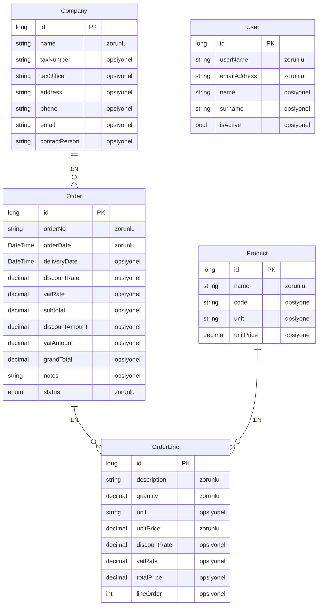
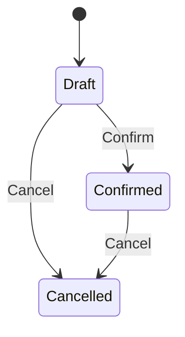
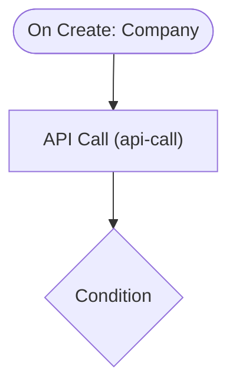

# companyapp — Talep Analizi

> Bu belge Archipid talep olgunlaştırma (discovery) akışıyla üretildi.

## Orijinal Talep

bir sipariş formu uygulaması istiyorum kullanıcı 
kullanıcı sipariş kalemlerinden bir form oluşturacak bu forma firma bilgileri eklenecek. ve form  oluşturulacak sonra bu formun pdf çıktılarını alacağım

## Özet

Bu uygulama, kayıtlı firmalar ve ürün kataloğu üzerinden sipariş formu oluşturmanızı, iskonto ve KDV bilgilerini girmenizi, hazırladığınız formun PDF çıktısını almanızı sağlar.

Kullanıcı yeni bir sipariş açar, listeden bir firma seçer ve katalogdan ürün seçerek kalem kalem adet, birim fiyat, iskonto ve KDV oranı girer. Kalem toplamları ile genel toplam manuel olarak girilir. Form taslak hâlde kaydedilir; hazır olduğunda 'Onayla' ile Confirmed durumuna alınır. Sipariş listesinde her satırın yanındaki PDF butonuna tıklanarak sipariş formu PDF olarak indirilebilir.

## Kapsam

- (belirtilmedi)

## Kapsam Dışı

- (belirtilmedi)

## Açık Noktalar

- (belirtilmedi)

## Eksiklikler

- (belirtilmedi)

## Öneriler

- (belirtilmedi)

## Veri Modeli

### Company — Firma

| Alan | Tip | Zorunlu | Uzunluk |
|---|---|---|---|
| `id` | long | Evet | — |
| `name` | string | Evet | 200 |
| `taxNumber` | string | Hayır | 20 |
| `taxOffice` | string | Hayır | 100 |
| `address` | string | Hayır | 500 |
| `phone` | string | Hayır | 20 |
| `email` | string | Hayır | 256 |
| `contactPerson` | string | Hayır | 200 |

**Neye bağlı:** Order (1:N, bu tablo "bir" tarafı)

### Product — Ürün

| Alan | Tip | Zorunlu | Uzunluk |
|---|---|---|---|
| `id` | long | Evet | — |
| `name` | string | Evet | 200 |
| `code` | string | Hayır | 50 |
| `unit` | string | Hayır | 20 |
| `unitPrice` | decimal | Hayır | — |

**Neye bağlı:** OrderLine (1:N, bu tablo "bir" tarafı)

### Order — Sipariş

| Alan | Tip | Zorunlu | Uzunluk |
|---|---|---|---|
| `id` | long | Evet | — |
| `orderNo` | string | Evet | 50 |
| `orderDate` | DateTime | Evet | — |
| `deliveryDate` | DateTime | Hayır | — |
| `discountRate` | decimal | Hayır | — |
| `vatRate` | decimal | Hayır | — |
| `subtotal` | decimal | Hayır | — |
| `discountAmount` | decimal | Hayır | — |
| `vatAmount` | decimal | Hayır | — |
| `grandTotal` | decimal | Hayır | — |
| `notes` | string | Hayır | 1000 |
| `status` | enum (Draft,Confirmed,Cancelled) | Evet | — |

**Neye bağlı:** Company (1:N, bu tablo "çok" tarafı) · OrderLine (1:N, bu tablo "bir" tarafı)

### OrderLine — Sipariş Kalemi

| Alan | Tip | Zorunlu | Uzunluk |
|---|---|---|---|
| `id` | long | Evet | — |
| `description` | string | Evet | 200 |
| `quantity` | decimal | Evet | — |
| `unit` | string | Hayır | 20 |
| `unitPrice` | decimal | Evet | — |
| `discountRate` | decimal | Hayır | — |
| `vatRate` | decimal | Hayır | — |
| `totalPrice` | decimal | Hayır | — |
| `lineOrder` | int | Hayır | — |

**Neye bağlı:** Order (1:N, bu tablo "çok" tarafı) · Product (1:N, bu tablo "çok" tarafı)

### User — Kullanıcı (Sistem)

| Alan | Tip | Zorunlu | Uzunluk |
|---|---|---|---|
| `id` | long | Evet | — |
| `userName` | string | Evet | 64 |
| `emailAddress` | string | Evet | 256 |
| `name` | string | Hayır | 128 |
| `surname` | string | Hayır | 128 |
| `isActive` | bool | Hayır | — |

**Neye bağlı:** bağımsız tablo

## İş Akışları

### Sipariş — durum makinesi

### Akış: Flow 1

## Elle Geliştirme Gerektirenler

Aşağıdaki maddeler senaryonun gereği ama üretilen koda yansımıyor — kod yazılması gerekir.

| Alan | İş | Neden | Geçici çözüm |
|---|---|---|---|
| entity | Kalem toplamları ve sipariş geneli hesaplamalar otomatik yapılmıyor | totalPrice = quantity × unitPrice, subtotal, discountAmount, vatAmount, grandTotal gibi hesaplanan alanlar desteklenmiyor; alanlar düz saklanır. | Kullanıcı kalem başına toplam fiyatı ve sipariş geneli KDV/iskonto/genel toplam tutarlarını kendisi girerek formu tamamlayabilir. |
| entity | Sipariş numarası otomatik üretilmiyor | Sequence/numaratör (ör. SIP-2025-0001) üretimi desteklenmiyor. | orderNo alanı serbest metin olarak kalır, kullanıcı kendisi girer. |
